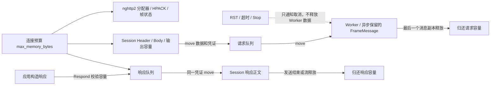

# T08：预算、背压与公平调度

本轮接在 [T07 生命周期](http2_lifecycle.md) 之后，仍使用显式 HTTP/2 Session。
HTTP/1/2 自动选择属于 T09；这里不增加 TLS 或流式业务接口。

## 字节跟着数据走

原来的 max_buffered_body_bytes 只统计 Session 内的正文 size。请求 move 到 Worker 后，
计数已经减少，但内存仍存在；很大的 vector.capacity 也不反映在 size 中。
现在增加共享 MemoryBudget 与 MemoryReservation，预算按所有权生命周期归还。

- 每个 HTTP/2 Session 的 max_memory_bytes 默认 **64 MiB**。包括 nghttp2 自定义分配器
  的分配大小与对齐记录、Header/string/vector 的保留容量、接收/编码缓冲、尚在 Worker
  或响应队列中的数据。C++ stream、索引和事件容器另外按每个允许并发流 1 KiB 预留
  保守的固定额度；配置连这部分都容纳不下时工厂返回 nullptr。
- MemoryBudget 通过原子计数跨线程收费；MemoryReservation 由库当前所有者调整，消息
  move 保留凭证。释放 Session、取消请求、出队或 handler 返回，都不等于释放一个被应用
  异步保留的 FrameMessage。只有最后一个相关凭证释放，容量才归还。
- ThreadPool::Create 的可选第四参数 max_retained_bytes 默认 **64 MiB**，限制所有
  已接受请求的 payload/metadata 容量与消息固定大小，包含正在执行及异步保留的消息。
  queued_count 与 retained_bytes 因此表达不同概念。请求数或字节数达到上限都会拒绝提交。
- SubReactorOptions.max_queued_response_bytes 默认 **64 MiB**，与响应条数同时生效，
  按所有协议的响应容量收费。响应出队归还队列额度；HTTP/2 的连接额度随 HttpResponse
  继续移动到对应 stream，不能在出队时一起释放。Respond 返回 false 时响应没有被接受。
- max_buffered_body_bytes 仍保留为 Session 内逻辑正文 size 的额外上限；跨 Worker 的
  外层限制由 max_memory_bytes 负责。连接额度与队列/线程池额度各自独立，不可相加作为
  实际占用：同一份数据可以同时受两个层级约束。

这里限制的是库保留的数据容量和协议分配，**不是进程 RSS 上限**。系统 allocator 的
元数据、扩容期间短暂的新旧分配，以及应用自行分配的数据不属于这个计数。应用复制
FrameMessage 会保留原凭证，但新增的数据副本、移走 payload 后独立保留的数据，以及
自行扩容的 vector/string 都由应用管理。不要修改库附带的 memory/worker_memory 字段。
请求和新响应并存时分别收费，不提供应用缓冲复用的自动零拷贝额度转移。

## 饱和时只拒绝相应流

请求的 END_STREAM 到来后，Reactor 仍先检查请求 ID 与在途容量，再登记取消状态和
业务 timer，最后提交 Worker。若 Worker 的条数/字节额度已满，撤销刚登记的 timer，
通知取消，再在 owner 调用 Session::OnDispatchRejected。

HTTP/2 对该 stream 发 REFUSED_STREAM，不投递它的业务；其他流、PING、SETTINGS 与
WINDOW_UPDATE 仍可继续。旧 Codec 默认从这个 hook 返回错误，保留原来的整连接关闭
策略。达到每连接在途上限也走同一拒绝入口，不依赖 moodycamel 跨 producer 的顺序。

接收端的初始 stream window 取 65535、单流正文上限、Session 累计正文上限和连接内存
额度一半中的最小值。连接初始窗口仍遵守 HTTP/2 的 65535 字节协议规则。DATA 在成功
放入有额度的缓冲，或拒绝后丢弃时及时归还流控 credit；不会等 Worker 完成才归还，
所以超过初始窗口的大整包请求仍可完成。没有容量时拒绝对应流，不能无限聚合正文。

应用缓冲/请求准入不足通常只影响对应流。若 nghttp2 自己无法在硬预算内分配协议状态，
或者连错误控制帧也无法分配，则关闭连接；不能承诺资源彻底耗尽后仍必然发送 RST。

## 每轮工作有上限

| SubReactorOptions | 默认值 | 范围 |
| --- | --- | --- |
| max_read_bytes_per_turn | 64 KiB | 每连接每轮 socket 接收字节 |
| max_write_bytes_per_turn | 64 KiB | 每连接每轮 socket 发送字节 |
| max_decode_calls_per_turn | 64 | 每连接每轮 Session 输入调用 |
| max_response_commands_per_turn | 64 | 每个 SubReactor 每轮响应/期限控制命令 |

这些上限必须为正。EventLoop 的 turn 编号让同一连接的原生就绪回调、响应处理和续调度
共享本轮计数，不能换一个入口就重新获得额度。HTTP/2 每次 OnInput 最多消费一段 preface、
一个帧头片段或一个帧 payload 片段；payload 还有 max_input_chunk_bytes 限制。因此即使
大量无 payload 控制帧粘在一起，64 次输入调用也只能处理有界数量的帧，而非一次吃完。

预算用完后，连接通过 owner-only EventLoop::Defer 登记一次续调度；读/写标记合并，
按连接 ID 重新查找，关闭后的旧任务失效。下轮先以零等待轮询真实就绪，再执行一批
有上限的 deferred callbacks；deferred callback 内再次 defer 的工作留到后续轮次。
这既处理已读进用户缓冲的剩余输入，也继续读取尚在内核里的数据，避免 epoll ET 因没有
新边沿而停住。遇到 WouldBlock 后停止主动续调度，等待真正的 socket 就绪。

HTTP/2 支持按调度 slice 增量编码；旧 Codec 仍在 max_pending_output_bytes 内整包编码，
只切分实际 socket 发送，不能把旧协议的大响应误判为超过一个小调度 slice 的非法消息。
半关闭接收仍受原有固定 64 KiB 和绝对期限保护，不改变 T07 的有限排空语义。

## 验证和下一轮

- memory_budget_test：并发额度争用、失败扩容不改计数、Worker 已出队/已取消但异步
  保留消息时额度不提前返回，释放后恢复提交。
- scheduling_test：持续 defer 的热任务不能跳过真实 I/O 轮询，也不能在同一轮递归执行。
- http2_session_test：消息移出 Session 后的真实容量保留、RST/Session 析构后仍持有
  请求、超大 capacity 的小响应拒绝、多流累计容量耗尽及释放恢复。
- 真实 TCP：Worker 队列满时拒绝单流、仍往返 PING、释放 handler 后恢复；响应队列
  按 capacity 拒绝；1 次解码、17 字节读、7 字节写、1 条响应命令下完成多流与排空；
  200 个 PING 的控制洪流，连同既有零窗口恢复、大 Body/CONTINUATION、慢流隔离测试。

任务执行结果和平台证据记录在 [HTTP2_TASKS.md](../HTTP2_TASKS.md)。下一轮 T09 将
探测器接入 HTTP Session factory；自动协议选择仍需遵守上述预算与调度契约。
