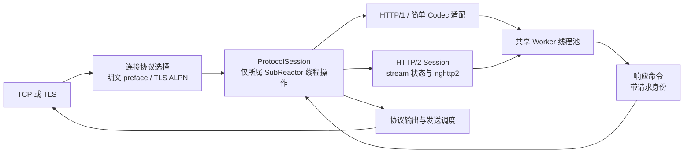
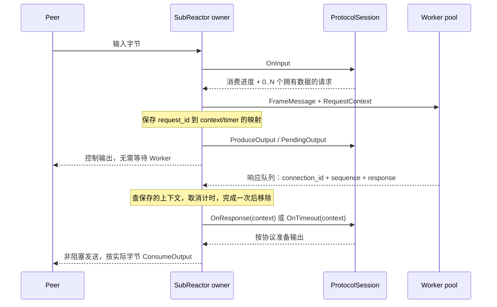

# HTTP/2 设计与分批接入

任务进度和每轮交接统一记录在根目录 [HTTP2_TASKS.md](../HTTP2_TASKS.md)。目前已实现
T01–T05：协议识别、无业务消息消费、已接入 Reactor 的会话层与旧 Codec 适配，
以及固定的可选 nghttp2 依赖。T05 的 Linux CI 尚待运行，尚未提供可用 HTTP/2 服务端。

## 如何自适应版本

HTTP/1 的版本在请求行，例如 `GET / HTTP/1.1\r\n`，不是普通 Header 字段。
HTTP/2 明文 prior knowledge 以固定的 client preface 开始：

```text
PRI * HTTP/2.0\r\n\r\nSM\r\n\r\n
```

这是 24 个字节的连接起始标记，不能把任意带有 `HTTP/2.0` 的文本请求当成 HTTP/2。
识别器保留半包，完整匹配后才选择 HTTP/2；实际接收 preface 及随后 SETTINGS 等帧
由会话层负责。探测不消费输入，所以不会丢掉 preface 或同次 recv 中的后续帧。

HTTPS 使用 TLS ALPN 的 h2/http/1.1 协商，不能探测 TLS 密文。选定协议族后不再切换；
HTTP/1 每条请求的版本仍由 HTTP/1 parser 检查。自动选择只用于明确配置的 HTTP 入口，
不改变默认长度前缀或显式 RPC 连接的语义。旧式 Upgrade: h2c 不纳入首版。

## 分层目标



网络帧、HTTP 消息、业务请求需要分开：多个 DATA 帧可组成同一个请求，不同 stream
的帧可交错；SETTINGS、PING、WINDOW_UPDATE 等控制帧不应制造 FrameMessage。
初期按有界 Body 聚合完整请求，后续再增加流式事件。stream 是连接中的状态对象，
不对应新线程或单独的 moodycamel 队列。

ProtocolSession 已能消费输入、产生请求/控制输出、处理带请求身份的响应与超时、
按预算输出以及进入 drain 状态。现有 ProtocolCodec 已经是每连接有状态对象，
但 DecodeResult 的单段 payload 及 Encode 的单次追加能力不足以表达所有这些动作。

T03 的无业务消息消费状态经 T04 的 Codec 适配器映射为会话输入进度，不等于 HTTP/2 ACK。
状态必须严格前进，不能以“控制帧”为由接受零消费而导致事件线程忙循环。

## 所有权、顺序与请求身份

- SubReactor 管理 Session、HPACK、stream map、协议窗口和连接输出。
- Worker 只处理拥有数据的业务消息，响应通过现有显式 token 队列返回。
- ConnectionHandle 绑定连接身份，RequestContext 分开记录本地任务编号与可选 stream ID。
- HTTP/1 保留 pipeline sequence 排序；HTTP/2 跨 stream 独立推进，同流命令有串行约束。
- 当前 RespondUnordered 只是绕过 pipeline 缓存，不能代替 stream 生命周期及流控。
- HTTP/2 响应不继承 HTTP/1 的 reason phrase、Connection 或 keep-alive 线格式。

nghttp2 仅作为协议内核，不承担 socket/TLS I/O。Session 只在所属 Reactor 线程上驱动，
nghttp2 类型通过实现细节隐藏。T05 已固定 1.71.0 C 静态库，默认不启用；获取与离线构建
见 [http2_build.md](http2_build.md)。下轮 T06 再将该内核接入原生 Http2Session。

## 流控与内存

除已编码 socket 输出外，还需统计待编码响应正文，限制各流和全连接的总量。
接收窗口返还必须与真实缓冲预算关联：整包模式下不能等整个 Body 收完并交给 Worker
后才首次返还额度，否则大于窗口的请求可能永远收不完整。流式模式则按释放的缓冲
返还额度。一个 stream 慢时，仍要保证连接上的必要控制帧可以被解析和处理。

Worker 饱和时优先在流粒度拒绝或背压；不能直接沿用“任意 Submit 失败就关闭整个
HTTP/2 连接”的策略。限制解压后的 Header 大小，不能只限制线上压缩帧长度。

## 超时与关闭

业务超时、请求头接收超时、Body 空闲超时、连接握手/空闲超时分别建模。
OnTimeout 必须携带请求上下文，并根据响应发送阶段选择错误响应或 RST_STREAM。
取消只影响对应 stream；迟到业务响应在 owner 线程复核并拒绝。

连接优雅结束使用 GOAWAY 和明确的 drain 期限，完成允许继续的 stream 后再关闭。
这与目前 close-after-write 或直接 Stop event loop 的动作需要分开。

## 首批验证和兼容性

T02 验证半包、粘包、请求行界限、全部 preface 分割点及错误版本。T03 验证消费型
事件不提交 Worker、不占用业务 sequence/请求 timer，并拒绝无进度与越界结果。
原有 Codec、响应排序/无序回写、全局 timer 和日志回归必须继续通过。

README 的 HTTP/2 状态随每批更新。只有 Session、流控、流隔离与互操作验收完成后，
才能声明对应明文或 HTTPS 场景已支持，不能仅凭识别器通过测试就宣称支持 HTTP/2。

## 首批接口说明

`include/netlib/http_protocol.h` 提供 HttpProtocolDetector。每个待选择的明文 HTTP 连接
使用独立实例，Detect 接收逐步增长、尚未消费的连接前缀；不保存输入指针、不分配
动态内存，也不负责解析全部 Header。可在输入缓冲移动/扩容后继续探测。

- kNeedMore：继续接收，version 没有值。required_bytes 为下一步需要的总字节数，
  或在寻找 CRLF 时为 0。匹配 preface 的前缀时只请求下一个可区分字节，避免等满
  24 字节才检查短 HTTP/1 请求。
- kDetected：version 是 kHttp10、kHttp11 或 kHttp2。结果固定，不消费输入。
- kProtocolError：前缀格式或版本不支持、请求行超限、配置上限为 0，或待判定输入
  被缩短。错误结果也固定。

HTTP/1 请求行上限默认 8 KiB，包含 CRLF，不包括后续 Header/Body；HTTP/2 preface
使用独立固定大小。请求行增量扫描保留一个字节的 CRLF 重叠，不反复从头搜索；
完整请求行出现后进行基本 method/target/version 检查。URI 和所有 HTTP Header 的
完整语法仍由所选会话处理。HTTP/2 检测成功不代表后续 SETTINGS 已被验证。

`DecodeStatus::kConsumed` 的结果只用于输入推进。T04 中由适配器转换为 kProgress，Reactor 清除旧 decode target，
消费指定长度后继续解析粘包；所有请求容量、sequence、Worker 提交及 timer 注册都在
该分支之后，因此控制输入不占用业务请求资源。零进度、消费越界、非零 payload
offset/size 都被拒绝。现有 Codec 不必实现新纯虚函数，原行为保持兼容。

运行首批测试：

```bash
cmake --build --preset debug --target netlib_http_protocol_test netlib_reactor_test
ctest --test-dir build/debug -R "netlib_(http_protocol|reactor)_test" --output-on-failure
```

## T04 会话接口与请求身份

实现入口：[protocol_session.h](../include/netlib/protocol_session.h)、
[protocol_session.cc](../src/protocol_session.cc)、
[request_context.h](../include/netlib/request_context.h)。

| 接口 | 所属线程和契约 |
| --- | --- |
| OnInput(span) | owner 线程；kNeedMore 不消费、不产请求；kProgress 必须消费正数个字节，可产零个或多个拥有数据的 SessionRequest |
| OnResponse(context, response, mode, close) | owner 线程；上下文从 Reactor 的在途请求表取出；排序规则由 Session 决定 |
| OnTimeout(context) | owner 线程；收到同一请求的完整 RequestContext；无需猜测最近解码的请求身份 |
| ProduceOutput(byte_budget) | 生成或准备协议输出；预算包含已有 PendingOutput；返回 false 按致命错误关闭 |
| PendingOutput / ConsumeOutput | Session 拥有编码字节，Reactor 只消费 socket 实际发出的数量；不增加一份传输层输出副本 |
| WantsInput | 控制读事件；false 时可暂停注册；恢复时先解析 Reactor 已持有的未消费字节 |
| ShouldClose | 协议请求关闭；Reactor 必须先发送完 PendingOutput |
| BeginDrain | 进入会话排空状态；旧 Codec 停收新请求，等已接受请求完成，再发送完输出 |
| MaxInputBufferSize | 限制传输层未消费输入；Session 内部的 stream/body/待编码输出仍需 T08 独立预算 |

kNeedMore.required_bytes 为总未消费字节目标，必须大于当前输入，或用 0 表示未知。
kProgress.required_bytes 必须为 0。Reactor 拒绝零进度、消费越界、非法 NeedMore、
不连续的本地请求 ID，以及不遵守输出上限的 Session，防止接口错误变成忙循环或错误寻址。
PendingOutput 的 span 在下一次非 const Session 调用前有效。



RequestContext 中 request_id 从 0 连续递增，与 FrameMessage.sequence 相同，
只表示本连接内投递给 Worker 的任务身份。HTTP/1 适配器将它用作 pipeline 排序号；
HTTP/2 将另用 stream_id 寻址。例如本地 request_id=0 可以来自 stream_id=11，
request_id=1 可以来自 stream_id=7，完整请求的完成顺序不受 stream 数值排序约束。
RPC 线上请求 ID 继续保存在 RpcFrameMetadata 中，与以上两者分开。

Worker 可读取 message.request_context，回写仍使用 message.Respond()/RespondUnordered()，
响应队列只携带 connection_id 和 sequence。Reactor 查自己保存的 context 交给 Session，
不会采用业务侧修改后的 stream_id；重复响应和超时后的迟到响应在查表时丢弃。
Respond 返回 true 只表示命令入队，并不保证最终发送成功，也不表示请求尚未超时。
连接关闭时取消其全部 timer；timer 线程只投递事件，不访问 Session。

旧 API 保留：SubReactor::Create(..., codec_factory) 自动包装 CreateCodecSession。
现有 ProtocolCodec 子类无需增加纯虚函数。新的原生协议使用：

```cpp
netlib::ProtocolSessionFactory factory =
    [](netlib::ProtocolSessionOptions options) {
      return CreateMySession(options);  // 返回 unique_ptr<ProtocolSession>
    };
std::unique_ptr<netlib::SubReactor> reactor =
    netlib::SubReactor::CreateWithSession(options, workers, {}, factory);
```

factory 会在创建 Reactor 时用于验证，并在每个连接注册时创建独立实例。
options 中的 max_pending_responses 和 max_pending_output_bytes 来自 SubReactorOptions。
CodecSession 保留 ordered 缓存、unordered 完成占位、关闭策略和输出限额；
HTTP/1 超时仍是排序后的 504 并关闭，长度前缀与 RPC 仍在无安全错误帧时直接关闭。
原生 Session 可以利用 context 实现单 stream 超时，不必继承整连接关闭策略。

本轮 BeginDrain 只是会话钩子，尚无服务编排层的 drain 命令或 GOAWAY。
SubReactor::Stop 仍立即结束事件循环。取消事件、Worker 拒绝的流级处理、排空期限
和请求级有效性复核属于 T07/T08；目前 Submit 失败仍关闭整个连接。
原生 Session 的资源预算和 HTTP/2 正确性不能由 Codec 适配器测试代替。

T04 的验证入口：

```bash
cmake --build --preset debug
ctest --test-dir build/debug --output-on-failure
```

[protocol_session_test.cc](../tests/protocol_session_test.cc) 检查旧 Codec 的身份、排序、
占位去重、缓冲所有权、限额、部分写、HTTP 超时及 drain；
[session_reactor_test.cc](../tests/session_reactor_test.cc) 用合成会话与真实 TCP 检查
首包控制输出、输入控制输出、多请求批次、乱序 stream 回写、上下文传递、迟到响应、
读事件暂停/恢复及已有缓冲重放，并拒绝非法会话结果。

## 依据

- [RFC 9112：HTTP/1 请求行](https://www.rfc-editor.org/rfc/rfc9112.html#section-3)
- [RFC 9113：协议启动、ALPN 与 client preface](https://www.rfc-editor.org/rfc/rfc9113.html#section-3)
- [nghttp2：I/O 与单线程会话边界](https://nghttp2.org/documentation/programmers-guide.html)
