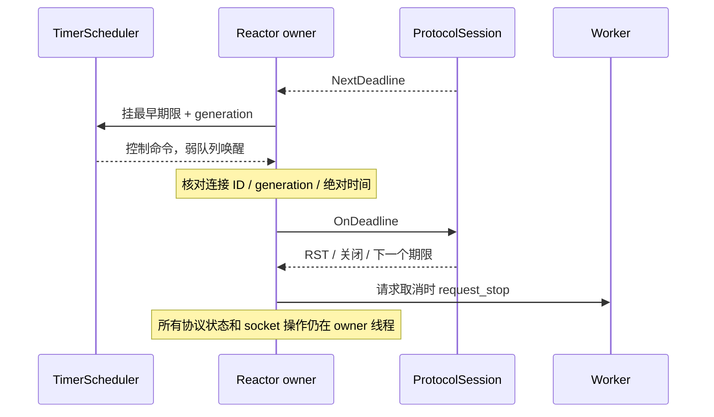

# T07：阶段超时、取消与有期限排空

本轮基于 [HTTP/2 会话](http2_session.md) 加入阶段期限、Worker 请求级取消通知，以及
MainReactor/SubReactor 的外部 Drain 入口。相同的外部排空、业务取消和 socket 写停滞
保护也适用于原有 Codec Session。构建开关仍见 [http2_build.md](http2_build.md)。

## 各阶段如何到期

| 阶段 | 配置 / 默认值 | 到期动作 |
| --- | --- | --- |
| HTTP/2 preface 与首个 SETTINGS | Http2SessionOptions.header_timeout，10 秒 | 关闭连接 |
| 未完成的网络帧 / HPACK Header 块 | header_timeout，10 秒，绝对期限 | 关闭连接；无法安全丢弃半帧或共享压缩状态的一部分 |
| Header 完成后等待正文 | body_idle_timeout，30 秒 | 有实际 DATA 字节时刷新；空闲超时重置该 stream，未完成请求不提交 Worker |
| 完整请求已提交 Worker | SubReactorOptions.request_timeout，10 分钟 | 停止该请求的 stop_token；HTTP/2 返回单流 504，旧 Codec 保留原超时策略 |
| 应用响应已被 owner 接受，等待协议发送 | response_timeout，30 秒，绝对期限 | 包含等待 peer 窗口；到期 RST_STREAM，不改写已开始的响应 |
| 用户态已有编码输出但 socket 无进展 | SubReactorOptions.write_timeout，30 秒空闲 | 仅成功 Send 刷新；到期关闭连接，不能从流中间丢弃传输字节 |
| 会话内部 GOAWAY 排空 | Http2SessionOptions.drain_timeout，30 秒 | 保留已接受的流；超时强制关闭连接 |
| HTTP/2 正常排空后的 TCP 半关闭 | SubReactorOptions.close_timeout，5 秒，绝对期限 | 先 shutdown 写方向，再丢弃尾部输入；peer EOF、累计 64 KiB 或到期时释放连接 |
| 外部服务排空 | MainReactor/SubReactor::Drain(timeout)，默认 30 秒 | 停止新连接，完成既有流或到期关闭；最后一个连接结束后 SubReactor 自动退出 |

以上可配置期限都必须大于 0 且不超过 24 小时。未收到任何新请求的普通 keep-alive
连接没有额外的全连接空闲期限；这与接收半帧/正文的超时不同。

业务期限以 **owner 接受响应的时刻** 为准。Respond 返回 true 只说明命令入队；即便
回复先于延迟的超时控制事件出队，只要实际已过截止时间，owner 仍执行超时并丢弃回复。
这样不会依赖 moodycamel 跨 producer 的出队顺序。

“写出”指 socket Send 已接受字节，不保证对端应用已接收。Windows 可能将一个很大的
send 接收到内核缓冲；内核已经接收的字节不属于用户态写停滞期限的检测范围。

## Worker 如何感知取消

FrameMessage 新增 C++20 stop_token 和 IsCancelled()。peer RST、业务超时、连接关闭、
强制排空或立即 Stop 会停止仍在途请求的 token；正常响应被接受即完成该业务请求，
其 token 不会因之后关闭连接而被补标为取消。

业务可以在长操作的边界检查 IsCancelled，或将 stop_token 传给支持取消的工作函数：

```cpp
void Handle(netlib::FrameMessage message) {
  if (message.IsCancelled()) return;
  // 执行业务；耗时操作可接收 message.stop_token 并配合取消。
  netlib::HttpResponse response{.headers = {}, .body = {'o', 'k'}};
  if (message.IsCancelled()) return;
  message.Respond(std::move(response));
}
```

std::stop_callback 可以用于非阻塞通知。request_stop 通常由 Reactor owner 调用，回调
会同步执行；如果注册时已经取消，回调也可能立刻在注册线程执行。回调不能阻塞、等待
Reactor、执行长任务或抛异常。支持 stop_token 的 condition_variable_any 等等待接口
可让 Worker 在取消后及时退出。

FrameMessage.Respond/RespondUnordered 会先拒绝已经取消的请求，但检查与实际入队仍
可能竞争；Reactor 保存的 context/截止时间仍是最终判定。直接使用 ConnectionHandle
回写的旧代码继续保持“入队成功不保证投递”的语义。取消是协作式通知，不强制终止 C++
Worker 线程；不配合取消的业务仍可能拖延 ThreadPool::Stop 的 join。

## 外部排空入口

服务编排线程可以使用：

```cpp
bool accepted = main_reactor->Drain(std::chrono::seconds(30));
// 检查 accepted；join 由编排线程执行，不要从 Reactor 回调中 join 自身。
main_thread.join();
for (std::thread& thread : sub_threads) thread.join();
workers->Stop();
```

MainReactor::Drain 停止接收并请求全部 SubReactor 排空；主循环退出时解除监听并关闭
监听 socket。SubReactor::Drain 可单独调用，立即关闭 AdoptConnection 的入口，清理
未注册的描述符，再在 owner 线程调用每个 Session 的 BeginDrain。返回 false 表示参数
非法、已经停止或通知失败；MainReactor 返回 false 时，其他 SubReactor 可能已开始排空。

重复 Drain 可以缩短期限，不能延长期限。外部期限与会话内部 drain_timeout 同时生效，
以先到者为准。到期时关闭剩余连接、取消业务 token 和所有闹钟，停止事件循环。
Stop 仍是立即退出路径；退出清理同样关闭活跃连接、作废句柄并通知在途业务取消。

HTTP/2 的 GOAWAY 固定最后接受的 stream ID，后续新流不投递业务。已接受的 Header/Body
和响应继续处理，因此不会关闭 DATA/WINDOW_UPDATE 的读兴趣。peer GOAWAY 也会进入
有期限的本地排空。旧 Codec 停止接受新请求，等待已经派发的响应，再写完输出。

HTTP/2 的最后一个响应和 GOAWAY 写完后，不能立即完全关闭 socket：对端可能还没读到
服务端 SETTINGS，随后回写 SETTINGS ACK，触发 TCP reset，影响尚未读完的响应。
因此正常完成的 HTTP/2 Session 通过 ShouldHalfClose 选择 TCP 半关闭；Reactor 先作废
业务回写句柄并 shutdown 写方向，让对端收到 FIN，再保留只读兴趣，丢弃迟到的控制帧，
不再调用 Session 解码或派发业务。即使 epoll ET 已报告过可读，也会立即排空现有输入。
这个分阶段关闭方法对应 [RFC 9112 §9.6](https://www.rfc-editor.org/rfc/rfc9112.html#section-9.6)
描述的 TCP reset 问题；相同 TCP 行为也影响 HTTP/2。

close_timeout 从 shutdown 开始计算，收到尾部字节不会延长期限；会话排空期限或外部
Drain 可以更早终止，Stop 仍立即退出。丢弃输入累计达到 64 KiB 时也释放连接，限制
持续发送的对端占用 owner。on_closed 在最终释放描述符时通知，可能晚于业务句柄失效。
ShouldHalfClose 默认返回 false，旧 Session/Codec 保持原来的关闭策略，错误路径仍可
直接关闭；此阶段不保证对端应用已处理响应，也不承诺强制期限到达后的可靠送达。

## owner 闹钟与性能

ProtocolSession 提供默认无期限的 NextDeadline/OnDeadline，旧子类无需实现新增纯虚函数。
Http2Session 使用有序期限表及 stream 中的迭代器，更新为 O(log N)、删除为 O(1)，取
最早时间为 O(1)，不定期扫描全部 stream。轻量帧边界计数覆盖不足 9 字节的帧头和未收完
的帧，不重复解析 HPACK。Body 空闲计时只在实际数据到达时刷新。

每个连接至多挂一个协议/写停滞/半关闭闹钟，另外保留已有的每请求业务 timer。只有最早期限变化
才取消并重挂；每个 SubReactor 再有一个外部排空闹钟。TimerScheduler 的回调只经弱队列
投递控制命令，不访问 Session、Channel 或 socket。控制命令不受普通响应容量限制。



过时的协议/排空控制事件由 generation 拒绝，已完成或取消的业务由 context 表拒绝。
Timer/stop_source 在任务投递前登记，避免 Worker 已开始而失败清理时找不到取消状态。

## 验证和后续

[drain_test.cc](../tests/drain_test.cc) 覆盖完整响应后自动退出、拒绝新连接、重复排空不
延长期限、强制排空/立即 Stop 的 token 和回调线程、真实 socket 写停滞，以及故意延迟
调度回调时过期回复仍被拒绝。写停滞用例使用小发送缓冲和分块的真实 Codec 输出。
[http2_session_test.cc](../tests/http2_session_test.cc) 覆盖各阶段确定性期限、正文续传后
旧期限不误杀、零窗口响应超时、GOAWAY 最后 stream ID 与新流边界、真实 TCP 排空和
握手超时，并继续检查 RST/业务超时后的迟到回写。
TCP 排空增加 FIN 后才回写 SETTINGS ACK、按单字节接收的确定性场景，检查全部响应、
GOAWAY 和 EOF；通用排空测试验证半关闭后的 peer EOF、close_timeout、外部期限、Stop
及尾部输入上限。这些用例不靠延长睡眠或忽略 socket 错误规避竞争。

T08 已加入跨队列容量预算、Worker 满时的单流拒绝和每轮公平续调度，见
[http2_backpressure.md](http2_backpressure.md)。取消不会提前归还 Worker 仍持有的内存。
T09 才做 HTTP/1/2 自动选择，TLS/ALPN 和流式业务仍属后续阶段。
