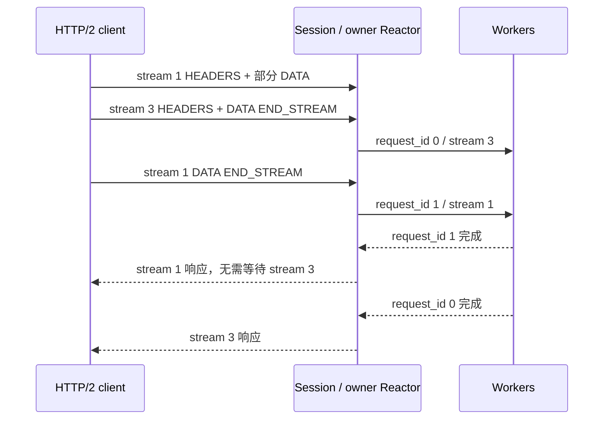

# 原生 HTTP/2 会话（T06）

开启 `NETLIB_ENABLE_HTTP2=ON` 后，可以通过显式工厂处理明文 prior-knowledge HTTP/2。
已支持 preface、SETTINGS/ACK、HPACK HEADERS/CONTINUATION、DATA、PING、多流请求
聚合与独立响应。**同一端口的 HTTP/1/2 自动选择、TLS/ALPN 尚未实现**。
构建及依赖见 [http2_build.md](http2_build.md)，进度和后续入口见
[HTTP2_TASKS.md](../HTTP2_TASKS.md)。

## 接入

公开入口 [http2_session.h](../include/netlib/http2_session.h) 不包含 nghttp2 类型。
默认构建仍关闭该功能，此时 CreateHttp2Session 返回 nullptr，不会回退到别的协议。
开启后将工厂交给 SubReactor::CreateWithSession：

```cpp
#include <memory>
#include <utility>
#include "netlib/http2_session.h"
#include "netlib/sub_reactor.h"
#include "netlib/thread_pool.h"

std::unique_ptr<netlib::ThreadPool> workers = netlib::ThreadPool::Create(
    4, 4096, [](netlib::FrameMessage message) {
      message.Respond(netlib::HttpResponse{
          .headers = {{"content-type", "text/plain"}},
          .body = {'o', 'k', '\n'},
      });
    });
netlib::SubReactorOptions options;
std::unique_ptr<netlib::SubReactor> reactor =
    netlib::SubReactor::CreateWithSession(
        options, *workers, {}, [](netlib::ProtocolSessionOptions limits) {
          return netlib::CreateHttp2Session(limits);
        });
// 检查 workers/reactor 创建结果；按既有编排方式交给 MainReactor 并运行。
```

配置此工厂的连接只接收 HTTP/2。使用支持 HTTP/2 的 curl 可发送
`curl --http2-prior-knowledge http://127.0.0.1:8080/`；端口由 MainReactor 配置。
Windows 自带 curl 的功能以 `curl --version` 为准，不保证含 HTTP2 支持。

## 请求与回写

网络帧不直接对应业务请求。Session 为每个 stream 维护独立 Header/Body，只有
END_STREAM 后才向 Worker 发出完整 SessionRequest；控制输入不产生任务或 timer。
例如 stream 1 的 Body 未结束而 stream 3 已完成，首个本地 request_id=0 会绑定
stream_id=3，后续 request_id=1 再绑定 stream_id=1。

FrameMessage.metadata 使用 HttpRequestMetadata：method、target、version="HTTP/2"，
scheme/authority 保存对应伪头字段，headers 保留普通 Header，content_length 是完整正文
大小，payload 拥有正文。旧 HTTP/1 Codec 的 scheme/authority 仍为空。



Worker 继续使用 message.Respond(HttpResponse)。Session 使用 Reactor 保存的上下文寻址，
不按本地 request_id 重排跨流响应；Respond 与 RespondUnordered 两种提示在此协议中
均按 stream 路由。reason_phrase 不上网；Header 名转为小写，拒绝伪头、连接专用字段、
非法值和不匹配的 Content-Length。普通响应自动补 Content-Length；HEAD 不发送 DATA，
204/304 不发送正文。不合法的应用响应会重置该流，其他流可继续运行。

## 输出、流控和资源

实际实现见 [http2_session.cc](../src/http2_session.cc)。nghttp2 只在 owner Reactor 线程
调用，不操作 socket、不创建线程。使用 session_send 的便携 send_callback2 将字节复制到
Session 自有输出向量；回调在预算用尽时返回 WOULD_BLOCK，部分帧由 nghttp2 保留。
这样即便另一个输入/响应触发协议调用，也不会引用已经失效的 mem_send2 内部指针。
Reactor 每次只 ConsumeOutput 已成功发送的字节，所有权不跨到 Worker。

发送服从对端连接与 stream 窗口。某流窗口为零时，仍读取 PING、WINDOW_UPDATE 等控制
输入，并允许其他流响应，不持续订阅没有输出的可写事件。接收端关闭自动窗口更新，
在数据存入有界缓冲或被丢弃后调用 consume 返还信用；不等到整个请求结束才更新窗口，
因此大于默认 65535 字节窗口的请求也能完整接收。

| Http2SessionOptions | 默认值 / 意义 |
| --- | --- |
| max_concurrent_streams | 128；还受 ProtocolSessionOptions.max_pending_responses 限制 |
| max_header_bytes | 64 KiB；解码后 name + value + 每字段 32 字节，包含伪头 |
| max_body_bytes | 16 MiB；每流请求与响应正文上限 |
| max_buffered_body_bytes | 32 MiB；Session 尚持有的请求和响应正文 size 合计 |
| max_input_chunk_bytes | 16 KiB；一次交给解析器的输入及传输输入缓冲上限 |

已编码输出另受 Reactor 的 max_pending_output_bytes 限制，支持比一个网络帧更小的
分批输出预算。正文预算统计有效字节数，不含 vector 容量、nghttp2 内部状态和已经移入
Worker 的正文；后者仍由线程池排队容量约束。系统级完整字节预算与背压属于 T08。
Header/正文超过限制时重置对应 stream，不投递不完整请求。

## 超时、取消和当前边界

收到 RST_STREAM 后，Session 发出带原始 RequestContext 的取消事件，Reactor 移除并取消
对应 timer，迟到响应查不到请求后被丢弃。协议输出也可能关闭 stream，因此除输入结果中
的 cancelled_requests 外，还提供 TakeCancelledRequests；Reactor 每次 ProduceOutput 后
回收这些事件。旧 Codec/自定义 Session 可以保留默认空实现。

业务响应等待超时发送单流 504；T07 增加 Header/Body 接收、响应发送、socket 写停滞与
排空期限。Worker 获得 stop_token 取消通知；BeginDrain/外部 Drain 在保留既有流读写的
同时提交 GOAWAY；正常排空后先 shutdown 写方向，限时接收尾部输入，peer EOF 后退出
或到期强制关闭。详见 [http2_lifecycle.md](http2_lifecycle.md)。

SubReactor::Stop 仍为立即停止接口，Drain 是有期限的优雅退出入口。T08 还需完善 Worker 饱和时的单流拒绝、
跨队列字节预算和每轮处理公平性。T09 才接入 HTTP/1/2 在线自动选择。
当前不支持 CONNECT 隧道、请求 trailers、流式业务 Body、1xx 中间响应和 server push。

## 验证

[http2_factory_test.cc](../tests/http2_factory_test.cc) 在 ON/OFF 下均编译，仅链接公开的
netlib::netlib，验证工厂和依赖宏隔离。
[http2_session_test.cc](../tests/http2_session_test.cc) 使用真实 nghttp2 客户端内核验证：

- 逐字节 preface/帧、HPACK CONTINUATION、交错正文、按完成时刻分配任务 ID。
- 7 字节输出预算/部分写，跨 stream 乱序回复，PING/SETTINGS 控制输入。
- 130000 字节请求跨窗口接收，发送窗口耗尽/恢复时其他 stream 仍能完成。
- Header、每流与累计正文限制，应用错误隔离，HEAD 无 DATA，畸形 preface 拒绝。
- 输入/输出两条取消事件路径，单流 504、GOAWAY 与迟到回复。
- 真实 TCP + SubReactor + ThreadPool 的多流乱序、单槽 timer 取消回收、真实定时超时。

```bash
cmake --build build/http2 --config Debug
ctest --test-dir build/http2 -C Debug -R "netlib_http2_.*test" --output-on-failure
```

本轮结果与限制记录在根目录任务清单；上轮 CI 成功不代表新提交代码已在 Linux 运行，
需以对应提交的 CI 结果为准。
