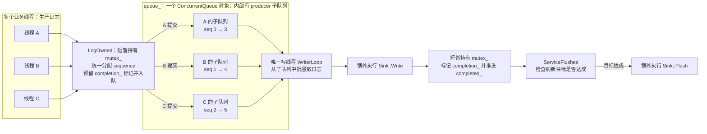
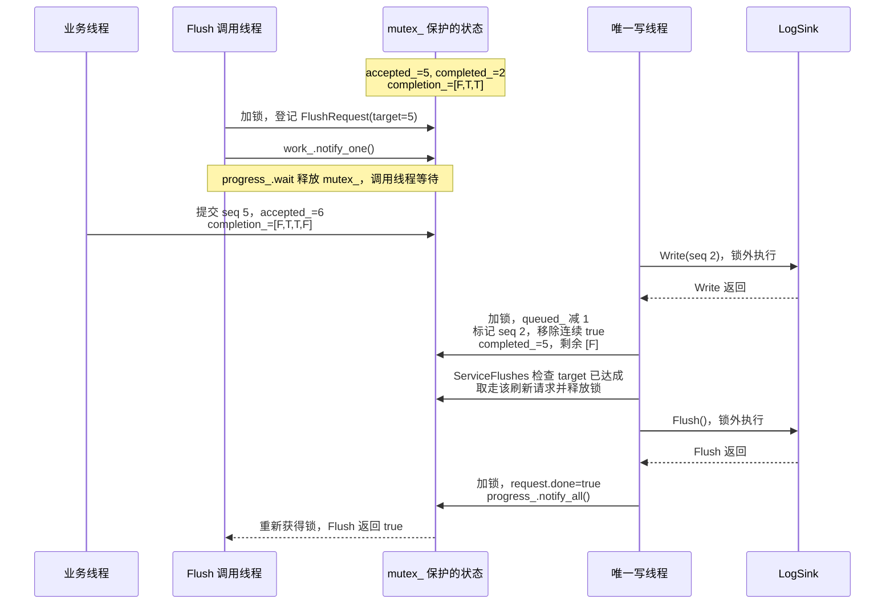

# 日志状态与刷新水位图解

本文对应 [Logger::Impl 的实现](../src/log/logging.cc)，解释多个业务线程提交日志、
一个写线程消费时，如何判断某次 Flush 是否可以完成。

先区分两个动作：**写完**表示 `LogSink::Write()` 已返回，写线程已登记完成；
**完成一次刷新**还需要在目标范围全部写完之后，再调用并完成 `LogSink::Flush()`。
`completed_` 跟踪前者，不表示这些日志已经 Flush，更不表示已持久化到磁盘。

## 1. 多个生产者，一个写线程



`sequence` 在同一个 Logger 内统一从 0 开始分配。当前不传 ProducerToken，
moodycamel 按调用线程获取或创建隐式 producer，并复用其子队列。
同一个 producer 的日志保持 FIFO，跨 producer 不承诺全局 FIFO。
即使在 `mutex_` 下依次提交 0、1、2、3、4、5，也可能按下面的顺序消费：

```text
成功提交的编号顺序：0 → 1 → 2 → 3 → 4 → 5
一种可能的写入顺序：0 → 3 → 1 → 4 → 2 → 5
```

消费者 token `consumer_` 用于复用消费状态，不会将这些子队列合并成全局有序队列。
写线程按实际出队顺序写日志；下面的状态跟踪用于保证刷新范围完整，不重排打印顺序。

## 2. 消息队列与完成窗口是两种结构

| 结构 | 存放什么 | 排列或访问方式 | 谁修改 |
| --- | --- | --- | --- |
| `queue_` | 拥有业务消息和元信息的 `LogRecord` | 各 producer 内有序，跨 producer 可以交错 | 生产者入队，写线程出队 |
| `completion_` | 每个已受理序号的一个 `bool`，不存放日志正文 | 严格按 sequence 从小到大排列 | 生产者在尾部添加 false；写线程标记并移除连续为 true 的队头 |

一条日志已经从 `queue_` 取出，并不代表它已经写完。它可能还在写线程的批次数组
`records` 中等待处理，或者正在执行 `Sink::Write()`；完成窗口中的标记仍为 false。

## 3. 用队头、队尾理解水位

假设序号 0、1 已连续写完，2 尚未完成，3、4 已经提前写完：

```text
             completion_: [completed_, accepted_)
           +---------+---------+---------+
index      |    0    |    1    |    2    |
sequence   |    2    |    3    |    4    |        5 (next)
written?   |    F    |    T    |    T    |
           +---------+---------+---------+
                ^                             ^
           completed_=2                  accepted_=5
```

- **`completed_` 是完成窗口队头对应日志的 sequence。** 上例队头对应 seq 2。
  它也表示所有 `[0, completed_)` 的日志已连续写完。
- **`accepted_` 是窗口尾部之后的下一个 sequence。** 上例已成功受理 5 条日志，
  下一条成功日志使用 seq 5。
- **`completion_[i]` 对应 seq `completed_ + i`。** 例如下标 2 对应 seq 4。
- **`queued_` 数的是仍为 false 的标记数量。** 上例只有 seq 2 尚未登记写完，
  所以 `queued_ = 1`，虽然窗口仍有 3 个元素。

窗口为空时没有队头，此时 `completed_ == accepted_`，且 `queued_ == 0`。
因此“completed_ 是队头日志的 sequence”需要带上“窗口非空”这个前提。

在 `mutex_` 保护下、一次状态更新完成后，可以用下面的关系核对状态：

```text
completion_ 覆盖的序号范围 = [completed_, accepted_)
completion_.size()        = accepted_ - completed_
queued_                   = completion_ 中 false 的数量
queued_ <= completion_.size() <= capacity_
```

容量限制检查 `completion_.size()`。提前写完的 true 标记会一直保留到前面的缺口
被填上，因此即使物理消息队列已经空出位置，完成窗口仍可能满；这时拒绝新日志，
避免未完成的低序号日志让跟踪状态无限增长。

## 4. 填上缺口，水位才会推进

沿用上例，假设当前有一次 `target = 5` 的 Flush，要求 seq 0..4 全部写完。
随后又成功提交了 seq 5，但它不改变这次 Flush 的目标：

| 时刻 | accepted_ | completed_ | completion_，括号内为对应序号 | queued_ | target=5 的状态 |
| --- | ---: | ---: | --- | ---: | --- |
| seq 2 未完成，3、4 已写完 | 5 | 2 | `[F, T, T]`，对应 2、3、4 | 1 | 等待 seq 2 |
| 新日志 seq 5 入队 | 6 | 2 | `[F, T, T, F]`，对应 2、3、4、5 | 2 | 目标仍为 5 |
| seq 2 写完，标记并推进水位 | 6 | 5 | `[F]`，只剩 seq 5 | 1 | 写入条件达成，可以执行 Sink::Flush |
| Sink::Flush 返回 | 6 | 5 | `[F]`，只剩 seq 5 | 1 | `done=true`，唤醒这次 Flush 的调用者 |

水位推进这一行，内部实际做了以下操作：

```text
标记 seq 2：completion_[2 - completed_] = true

completed_=2    [T, T, T, F]    对应 2、3、4、5
移除队头 true → completed_=3   [T, T, F]    对应 3、4、5
移除队头 true → completed_=4   [T, F]       对应 4、5
移除队头 true → completed_=5   [F]          对应 5
遇到 false，停止推进。
```

这里的出队是 `completion_.pop_front()`，只移除状态标记；日志正文此前已经从
`queue_` 出队并写过。两种出队发生在不同的结构上。

这个例子中 seq 5 可以在本次 Flush 完成后再写。实际运行中它也可能提前被写出，
因此 Flush 保证目标范围完整，不保证排除目标之后的日志。

## 5. Flush 的目标如何从登记走到完成

下面假设普通日志未触发逐条刷新，省略定时器和 WARN 以上级别的即时刷新：



`FlushRequest::target` 是受理数量快照，也是刷新范围的右开边界。
`target <= completed_` 只说明可以刷新；`done=true` 才说明目标达到后执行的
`Sink::Flush()` 已返回。写线程从 `requests_` 取走请求时，调用者仍通过 shared_ptr
持有同一对象，等待其 done 状态。

“Flush 之前的日志”以受理成功为边界：在 Flush 开始前已返回 true 的提交必然
包含在目标内；与快照并发、仍在格式化或等待提交锁的调用，以是否在快照前受理为准。

## 6. 每个状态由谁维护

| 状态或对象 | 形象理解与用途 | 更新位置 |
| --- | --- | --- |
| `accepted_` | 发号位置；每条成功日志领取当前编号，随后加 1 | LogOwned 成功入队后 |
| `completed_` | 完成窗口队头的序号；窗口为空时等于 accepted_ | 写线程连续移除 true 队头时 |
| `completion_` | 按编号排好的完成标记，不是日志消息队列 | LogOwned 预留 false；写线程标记 true、移除连续 true |
| `queued_` | 仍未登记写完的日志数量，含已出队和正在写的记录 | 成功受理加 1；写线程完成登记时减 1 |
| `capacity_` | 完成窗口最多保留多少个序号 | 构造时确定；LogOwned 检查 |
| `requests_` | 显式 Flush 请求的等候队列，各自有固定 target | Flush 登记；ServiceFlushes 取走已达标请求 |
| `FlushRequest::done` | 某次显式刷新已完成的回执 | Sink::Flush 返回后由写线程置为 true |
| `periodic_target_` | 定时器留下的一张刷新目标便签 | 定时器登记；ServiceFlushes 达标后取走 |
| `dropped_` | 累计丢弃计数 | 容量不足或预留、入队失败时调用 Drop |
| `unreported_drops_` | 留给下一条成功日志报告的丢弃数量 | Drop 累加；附在成功入队日志上后清零 |
| `stopping_` | 关闭提交入口，同时要求写线程收尾 | Stop 或写线程异常时置为 true |
| `failed_` | 写线程异常标记，让 Flush 等待者可以返回失败 | WriterLoop 的异常处理 |
| `mutex_` | 让提交编号、完成标记、刷新快照和停止状态保持一致 | 生产者、写线程、定时器、Flush/Stop 调用方短暂持有 |
| `work_` | 给写线程的门铃 | 新日志、显式/定时刷新、Stop 发通知 |
| `progress_` | 给 Flush 等待者的完成通知 | 显式刷新完成或写线程异常时 notify_all |
| `stop_mutex_` | 让多个 Stop 调用串行等待同一次完整退出 | Stop 持有，直到后台线程 join 完成 |
| `timer_` | 定期登记目标，不执行 Sink I/O | 构造时按配置启动，Stop 时停止 |
| `writer_` | 唯一执行 Sink::Write/Flush 的线程 | WriterLoop；正常排空刷新后退出，或异常退出 |

这里对 queued_ 的“写完”判断包含写线程的完成登记。若该记录还要立即刷新，
`flush_each_record_` 或 WARN 以上级别触发的 Flush 也会在完成登记之前执行。

## 7. LogOwned 如何避免留下永远补不上的缺口

提交过程在同一个 `mutex_` 临界区中完成：

```text
检查 stopping_ 与完成窗口容量
    ↓
record.sequence = accepted_
record.dropped_messages = unreported_drops_
    ↓
completion_.push_back(false)     先预留对应编号的标记
    ↓
queue_.enqueue(record)           发布消息
    ├─ 失败：pop_back 撤销预留，记录 Drop，不增加 accepted_
    └─ 成功：清零 unreported_drops_，accepted_++，queued_++，通知写线程
```

如果预留 false 自身失败，同样记录 Drop 并拒绝提交；如果已经停止或日志级别被过滤，
则直接拒绝，不计入 Drop。成功编号连续，失败提交不占编号，Flush 不会等待一条
从未成功发布的日志。写线程完成登记也要获取同一把锁，因此无法看到提交过程的半成品。

## 8. 定时刷新和停止复用同一套水位

定时器在 `periodic_target_` 没有值时记录 `accepted_`，有待处理目标时保留原值，
合并后续 tick。持续提交新日志不会让这张便签的目标不断后移。
optional 中存着 0 也表示存在一个刷新目标，与没有值不同。

正常 Stop 的流程是：关闭提交入口 → 停止定时器 → 写线程处理完已受理日志和
已登记的显式刷新请求 → 最终 Flush → 写线程退出，Stop 完成 join。
关闭入口后 accepted_ 不再增长，`completed_ == accepted_` 就表示已全部写完。
ServiceFlushes 在最终 Flush 返回后才返回 true，WriterLoop 随之退出。

如果 Sink 等操作抛出异常，写线程会设置 failed_、stopping_ 并唤醒 Flush 等待者；
这些等待者可返回 false，剩余日志不保证完成。Stop 仍会等待线程退出。
标准输出 Sink 使用 fflush；文件系统断电持久化和 FILE* I/O 错误上报不在当前保证内。
