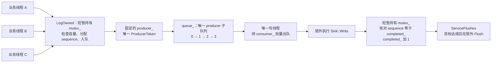
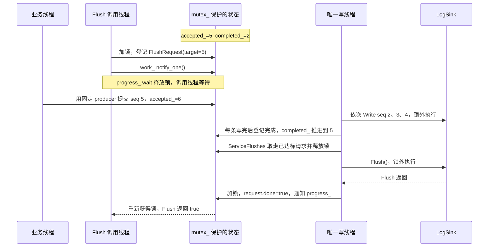

# 日志状态与刷新水位图解

本文对应 [Logger::Impl 的实现](../src/log/logging.cc)。当前每个 Logger 固定一个
显式 ProducerToken，由多个业务线程在同一把锁下轮流使用；只有一个写线程消费。
日志按受理序号写出，因此已经删除旧版用于追踪乱序缺口的 completion_。

先区分两个动作：**写完**表示 Sink::Write 已返回，写线程已登记完成；
**完成一次刷新**还需要在目标范围全部写完之后，再调用并完成 Sink::Flush。
completed_ 跟踪前者，不表示日志已经 Flush，也不表示已持久化到磁盘。

## 1. 多个调用线程，一个逻辑 producer



ProducerToken 不与某个 OS 线程永久绑定，但不能被多个线程同时使用。这里的
mutex_ 同时保护编号、入队和刷新快照，所以跨线程受理顺序与入队顺序一致。
LogQueueTraits 禁用了隐式 producer，防止后续代码绕过固定 token，重新引入子队列。

定时刷新和显式 Flush 通过状态及条件变量通知写线程，不向日志队列插入控制消息，
因此不会为这些控制动作创建其他 producer。

## 2. 用两个边界理解未完成日志

假设已经接受 seq 0..4，seq 0、1 已写完：

```text
              already written       accepted but not completed
sequence           0   1                 2   3   4             5 (next)
                                        ^                     ^
                                   completed_=2          accepted_=5

outstanding = accepted_ - completed_ = 3
```

- **accepted_ 是发号位置。** 上例成功受理 5 条，下一条成功日志领取 seq 5。
- **completed_ 是下一条应登记写完的 sequence。** 所有 [0, completed_) 已连续写完。
  单写线程写完 seq 2 后，直接将 completed_ 从 2 推进到 3。
- **[completed_, accepted_) 是未完成范围。** 不需要再为每个序号维护一个 bool。
- **queued_count() 等于 accepted_ - completed_。** 它包括仍在队列、已批量取出以及
  正在写的日志，不等于物理队列当前长度。

例如写线程把 seq 2、3、4 一次取入批次数组 records 后，消息队列可以已经为空，
但 completed_ 仍是 2，未完成数量仍为 3。所以不能将 completed_ 理解为物理消息
队列当前队头的序号。

在 mutex_ 下观察完成的一次状态更新，满足：

```text
0 <= accepted_ - completed_ <= capacity_
queued_count() = accepted_ - completed_
全部写完：completed_ == accepted_
```

容量仍约束所有尚未登记写完的日志，包含正在执行慢 I/O 的记录。这样批量出队
不会提前释放容量，慢 Sink 不会使待写日志无限增长。

## 3. 后续日志不延长已登记的 Flush 目标

沿用上例，显式 Flush 记录 target=5，要求 seq 0..4 写完。随后接受 seq 5：

| 操作 | accepted_ | completed_ | 未完成数量 | target=5 的状态 |
| --- | ---: | ---: | ---: | --- |
| 登记 Flush | 5 | 2 | 3 | 等待 seq 2、3、4 |
| 新日志 seq 5 入队 | 6 | 2 | 4 | 目标仍为 5 |
| 写完 seq 2 | 6 | 3 | 3 | 继续等待 |
| 写完 seq 3 | 6 | 4 | 2 | 继续等待 |
| 写完 seq 4 | 6 | 5 | 1 | 写入条件达成，可以执行 Sink::Flush |
| Sink::Flush 返回 | 6 | 5 | 1 | done=true，唤醒调用方 |
| 后续写完 seq 5 | 6 | 6 | 0 | 后续日志完成 |

这里每条日志写完后只执行 completed_++，不再标记和移除 completion_ 的队头。
写线程会断言 record.sequence == completed_，核对唯一 producer 的 FIFO 约束。

这个例子在 seq 5 写出前完成刷新。实际运行中后续日志也可能在登记刷新前就被写出，
或在刷新调用方醒来前继续写出。Flush 保证目标范围完整，不保证排除后续日志。

## 4. Flush 的登记与完成

下面省略 WARN 以上级别和 flush_each_record 触发的即时刷新：



target 是 accepted_ 的快照，也是范围的右开边界。target <= completed_ 表示可以刷新；
done=true 表示达标之后执行的 Sink::Flush 已返回。请求出队后，等待方的 shared_ptr
仍持有该请求对象。等待条件变量会释放 mutex_，业务提交不会等待 Sink I/O 完成。

“Flush 之前的日志”以受理成功为边界：在 Flush 开始前已返回 true 的提交必然包含
在内；仍在格式化或与快照并发的调用，以是否在快照前受理为准。

## 5. 每个状态的作用和更新位置

| 状态或对象 | 形象理解与用途 | 谁更新 |
| --- | --- | --- |
| accepted_ | 下一张日志编号；已成功受理总量 | LogOwned 入队成功后加 1 |
| completed_ | 下一条应完成的编号；此前日志全已写完 | 写线程按顺序登记后加 1 |
| capacity_ | 允许保留多少条尚未完成日志 | 构造时确定，LogOwned 检查两水位之差 |
| queue_ | 唯一 producer 子队列，拥有 LogRecord | 业务线程在锁下入队，写线程批量出队 |
| producer_ | 所有业务线程共用的显式生产者 token | 构造时创建；LogOwned 在 mutex_ 下使用 |
| consumer_ | 写线程独占的显式消费者 token | WriterLoop 使用 |
| requests_ | 显式 Flush 的目标等候队列 | Flush 登记，ServiceFlushes 取走达标请求 |
| FlushRequest::done | 一次显式刷新的完成回执 | 目标达成且 Sink::Flush 返回后置 true |
| periodic_target_ | 定时器留下的固定目标便签 | 定时器登记，ServiceFlushes 达标后取走 |
| dropped_ | 累计丢弃数量 | 容量不足或入队失败时 Drop 累加 |
| unreported_drops_ | 留给下一条成功日志报告的丢弃数量 | Drop 累加，附在成功入队日志上后清零 |
| failed_ | 让 Flush 等待者返回失败的异常标记 | WriterLoop 的异常处理 |
| mutex_ | 统一保护编号、token 使用、完成计数和控制状态 | 提交、写线程、定时器和 Flush 短暂持有 |
| work_ | 写线程的门铃 | 新日志、显式/定时刷新 |
| progress_ | Flush 调用方的完成门铃 | 显式刷新完成或写线程异常时通知 |
| detached Writer | 唯一执行 Sink::Write/Flush 的线程 | WriterLoop，进程结束时由 OS 回收 |

旧版 completion_ 与独立 queued_ 已删除。queued_count() 直接从两个水位计算。
WARN 以上级别或 flush_each_record 要求的即时 Flush 会在该记录登记完成前执行。

## 6. 提交失败、定时刷新和停止

LogOwned 先在锁外准备 LogRecord，再在 mutex_ 内执行：

```text
检查 failed_ 和 accepted_ - completed_ 是否达到容量
    ↓
record.sequence = accepted_
record.dropped_messages = unreported_drops_
    ↓
queue_.enqueue(producer_, record)
    ├─ 失败：Drop，accepted_ 不增加，下次可继续使用该编号
    └─ 成功：清零 unreported_drops_，accepted_++，通知写线程
```

现在没有预留完成标记，也没有需要回滚的 completion_ 元素。日志级别过滤和停止后
拒绝提交不计入 Drop；容量不足或入队失败才计入。成功编号连续，不会为失败提交留下缺口。

定时器只在 periodic_target_ 没有值时记录 accepted_，待处理目标保留原值，后续 tick
合并。目标为 0 仍是有效刷新请求，与 optional 没有值不同。

正常退出：生产者停止提交 → Flush 等待目标前日志完成并执行最终 Sink::Flush →
进程退出。Logger 不关闭提交入口、不 join Writer，也不执行隐式最终 Flush。

Sink 等操作抛出异常时，写线程设置 failed_ 并通知 Flush 等待者返回失败，剩余日志
不保证完成。标准输出 Sink 使用 fflush，不保证断电持久化，也未通过当前 void 接口
报告 FILE* I/O 返回码。

请求、响应和日志三条通道的 token 分布见[队列拓扑](queue_topology.md)。
