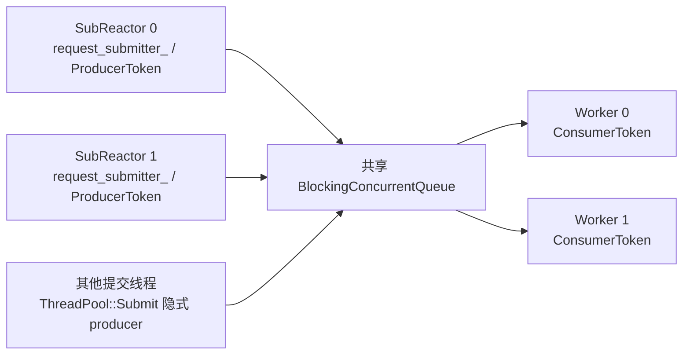
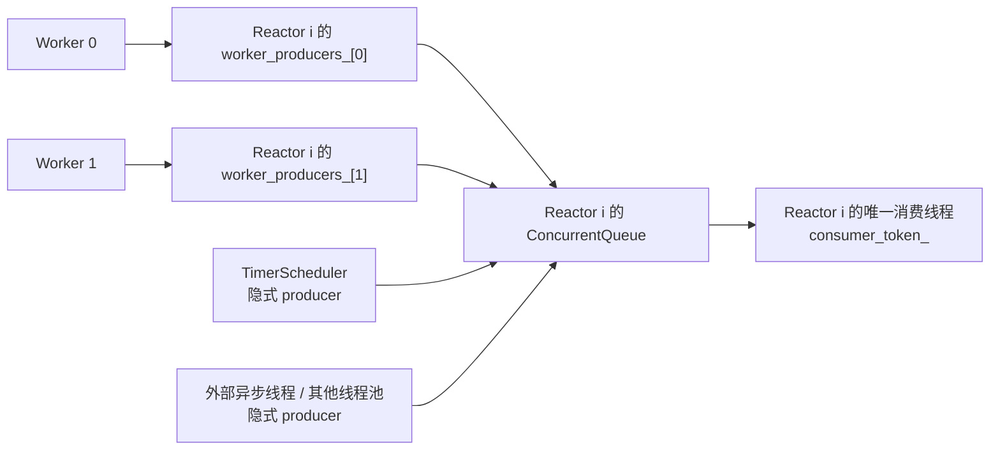
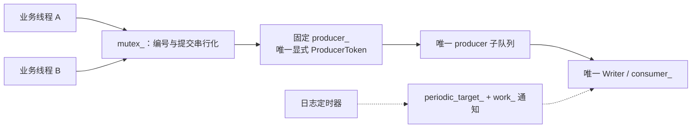

# 常驻线程与消息队列的 token 拓扑

以一个 ThreadPool、m 个 SubReactor、N 个 Worker、一个 Logger 为例：

| 通道 | 常驻生产者的显式 token | 常驻消费者的显式 token | 隐式入队来源 |
| --- | --- | --- | --- |
| 请求：SubReactor → ThreadPool | 每个 SubReactor 一个 Submitter，共 m 个 | 每个 Worker 一个 ConsumerToken，共 N 个 | 通用 ThreadPool::Submit 调用、Stop 控制消息 |
| 响应：Worker → SubReactor | 每个响应队列为 N 个 Worker 各准备一个 ProducerToken，共 m×N 个 | 每个 SubReactor 一个 ConsumerToken，共 m 个 | 定时器、外部线程或其他线程池的异步响应 |
| 日志：业务线程 → Writer | 一个共享 ProducerToken，由现有 mutex_ 串行保护 | Logger 写线程独占一个 ConsumerToken | 禁用；定时刷新和 Flush 使用状态通知 |

token 类型仍然隐藏在 src 内部，公开头文件不依赖 moodycamel。

## 请求方向

SubReactor 构造时通过 ThreadPool::CreateSubmitter 创建一个显式 producer。
仅其事件循环线程调用 request_submitter_.Submit；可由所有 Worker 共同消费，
不会把某个 SubReactor 固定绑定给一个 Worker。任务的执行及完成顺序仍不保证有序。

Submitter 可移动、不可复制，同一个句柄不能同时被多个线程使用；外部同步后可以
顺序换线程使用。默认构造或移动后的空句柄 valid() 为 false；producer 创建失败
也返回无效句柄。valid() 只判断句柄资源，不表示线程池仍接受任务。

Submitter 内部持有线程池状态的 shared_ptr，确保 producer token 析构前队列仍存在。
即使句柄比 ThreadPool 对象活得久，线程池对象析构时仍会 Stop/join；剩余句柄只保留
已停止的队列状态，Submit 返回 false，不会让工作线程继续运行。

## 响应方向

每个 ResponseQueue 构造时创建固定大小的 worker_producers_ 数组。token 由响应队列
拥有，队列销毁前先销毁这些 token。Worker 在线程入口登记 thread_local 的所属
线程池身份与 worker index，在退出时清除。EnqueueMessage 只让本线程池的 Worker
使用对应下标的显式 token；每个下标始终由同一个 Worker 独占。

其他线程池的 Worker 即使 index 相同，也不会借用本队列的显式 token，而是隐式入队。
业务层仍直接调用 ConnectionHandle::Respond，不必携带 Worker 编号或 moodycamel 类型。
正常编排中 ThreadPool 对象仍须比引用它的 SubReactor 活得久。
响应队列持有线程池身份状态的共享引用，避免在途外部 Respond 跨过关闭时刻时，
身份查询引用到已经销毁的 ThreadPool 对象；该共享状态不会延迟线程池对象的 Stop/join。

定时器线程只投递超时控制消息，不访问连接状态。控制消息继续保留现有容量豁免，
不会因为普通响应占满容量就被容量检查拒绝；它仍可能因资源失败或关闭而提交失败。
显式和隐式 producer 之间没有全局 FIFO。响应仍由 Reactor 按 connection ID、sequence
及请求状态处理，再通过每连接的响应缓存恢复线上顺序；token 本身不提供请求时序保证。

## 日志方向

日志关闭隐式 producer，避免线程数量决定子队列数量。唯一 producer 加上唯一消费者，
使写出顺序与受理 sequence 一致，完成状态简化为 accepted_、completed_ 两个计数。
日志的 Flush 使用现有状态和条件变量，不插入另一个 producer 的控制消息。
具体状态和刷新示例见[日志状态图解](logging_state.md)。

## ThreadPool 的关闭与排空

低频 Stop 消息使用隐式 producer，但不能靠其跨队列顺序判断数据已经排空。
ThreadPool::Stop 依次执行：

1. 用 admission_ 的最高位关闭提交入口，新 Submit 返回 false。
2. 等待 admission_ 低位的在途提交计数归零，确保此前进入提交过程的调用都已发布或失败。
3. 等待 outstanding_ 归零：所有成功入队的请求都已经完成 Handler。
4. 隐式 enqueue N 个 Stop 消息，每个 Worker 取一个后退出，最后 join。

admission_ 将“入口已关闭”和“在途提交数量”合并到一个原子字中，避免分别检查停止
标记、增加计数时漏掉并发提交。Stop 关闭入口后两个等待阶段的计数只会减少，
使用 C++20 atomic::wait/notify 等待，不忙轮询。outstanding_ 在发布请求前增加，
Handler 返回或入队失败时减少，覆盖排队和执行阶段；queued_count_ 则在请求出队时减少。

stop_mutex_ 让多个 Stop 调用都等待完整退出。Handler 不得调用自身线程池的 Stop，
否则会等待自己完成。Stop 通知若分配失败采用 fail-fast，避免 Worker 永久睡眠。

token 显式化不等于所有内存已预分配：队列仍按块管理存储，构造容量是预分配估计，
消息中的 vector/string 也可能分配。全局消息容量仍由现有计数检查负责。
